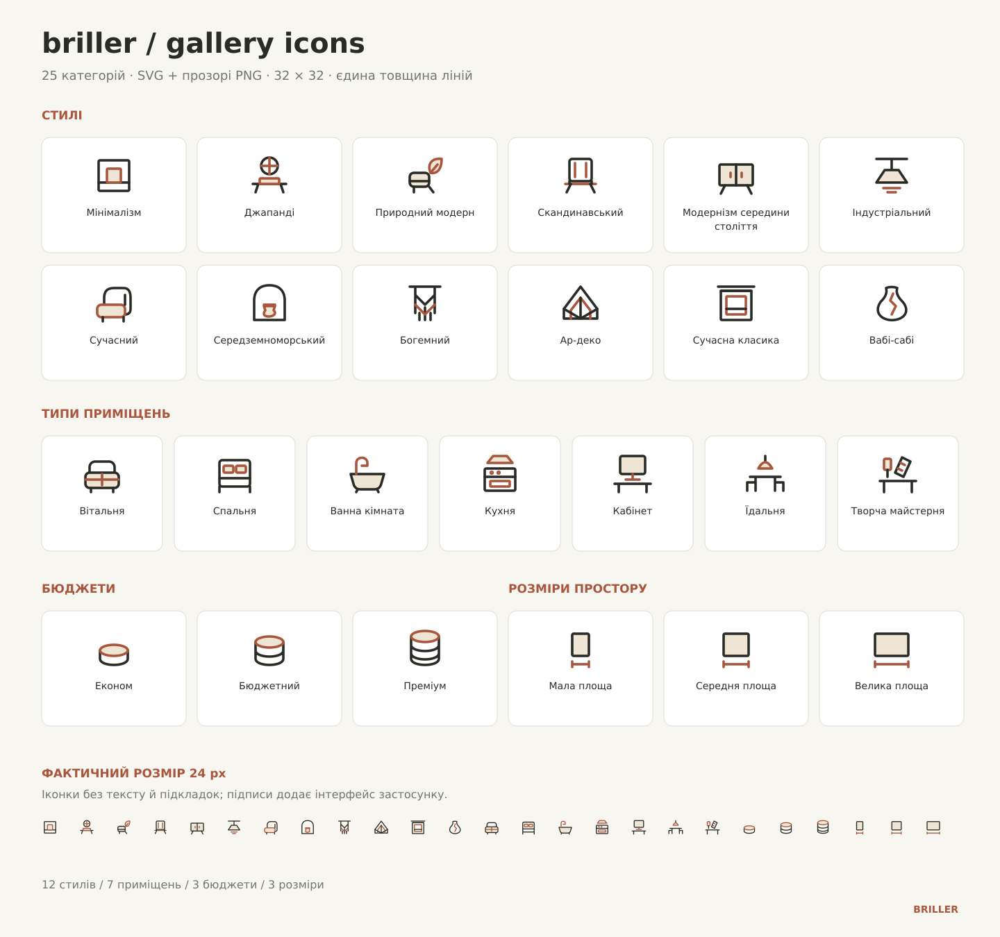
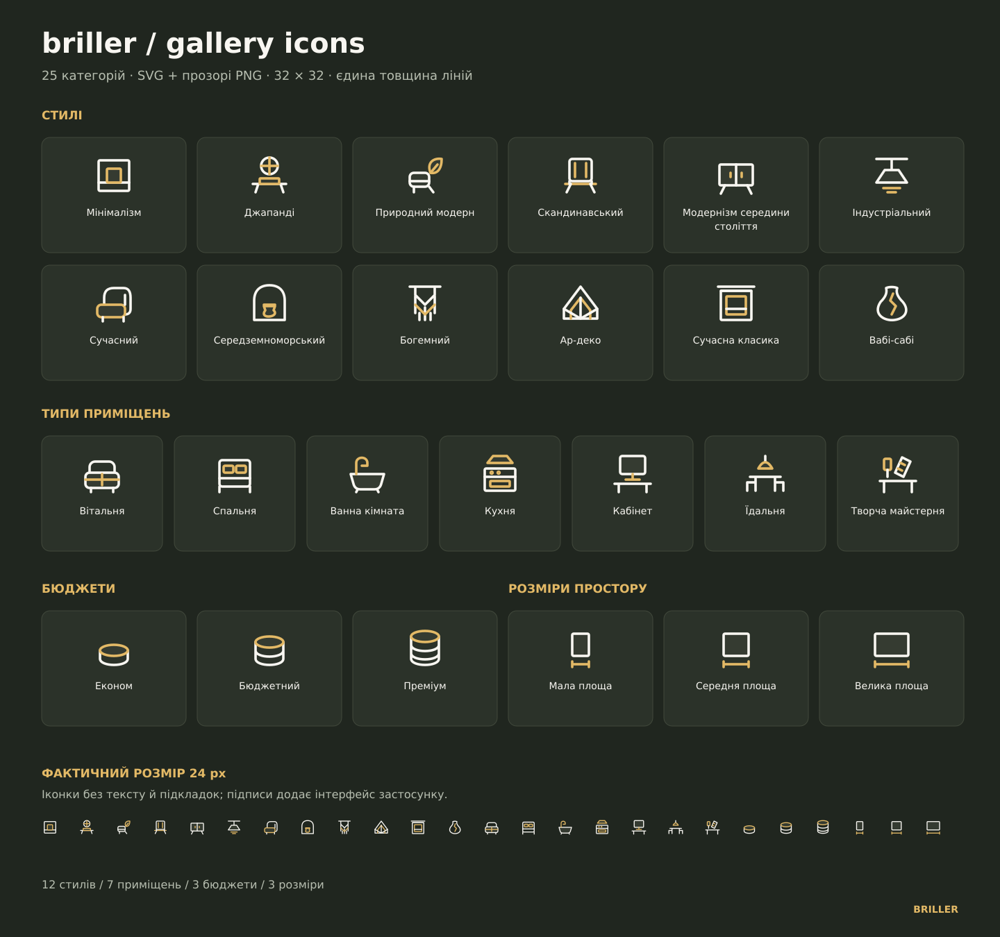

# Briller: іконки мобільної галереї

Ця окрема гілка містить лише ресурси іконок. Код сайту й розгортання не змінювалися.

## Завантаження

[Завантажити ZIP з усім набором](https://github.com/brillerhouse/website/raw/refs/heads/mobile-gallery-icons/briller-gallery-icons.zip)

25 категорій: 12 стилів, 7 типів приміщень, 3 бюджети та 3 розміри простору.
В архіві є SVG та прозорі PNG у світлому, темному й монохромному варіантах, JSON зі стабільними ID категорій і згенерований концепт-атлас.
Векторні іконки спрощено для читабельності в малому розмірі. PNG: 24, 48, 72 та 256 px.

## Прев’ю

Повний опис файлів і підключення — у README.uk.md всередині ZIP.
