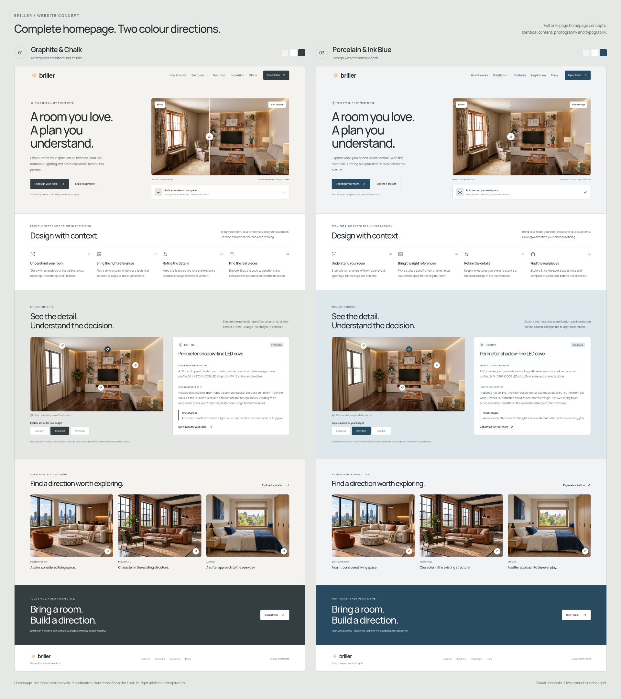
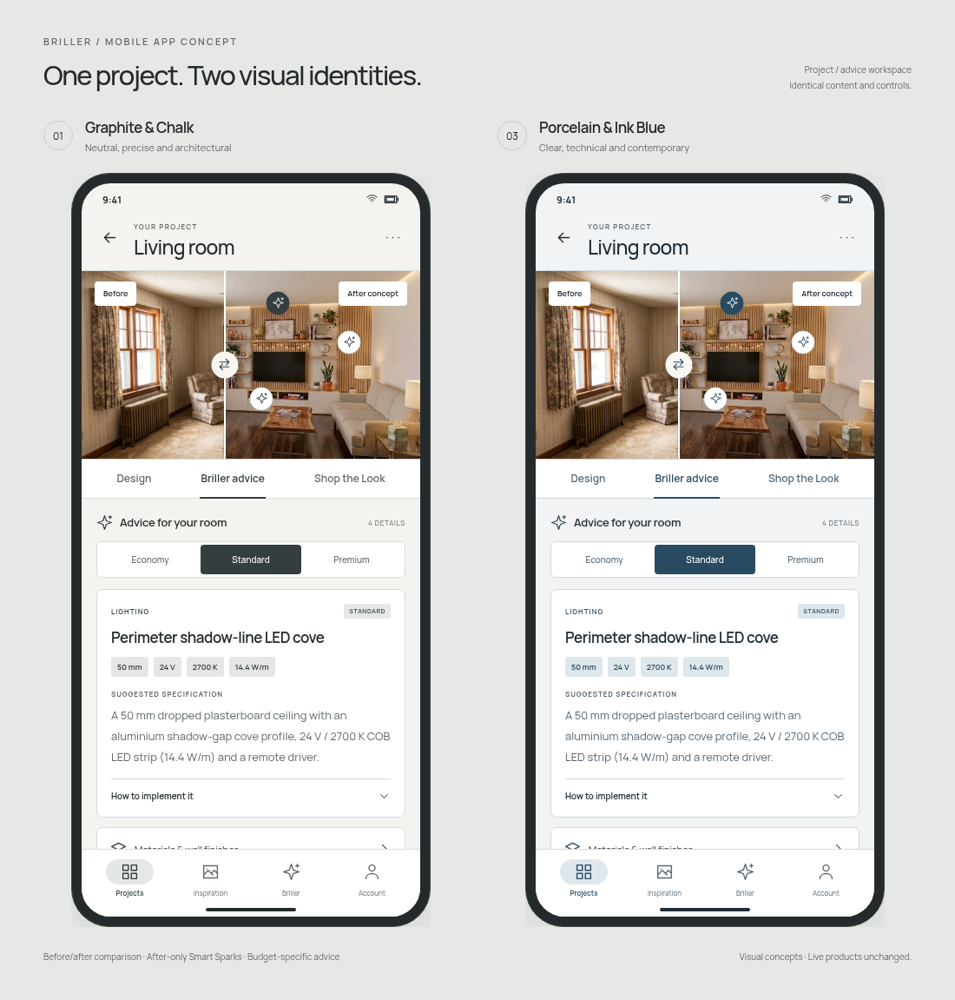

# Briller — website and app palette mockups

One full homepage concept and a mobile project/advice screen, each in two palettes:

- **01 Graphite & Chalk:** neutral, restrained, architectural.
- **03 Porcelain & Ink Blue:** clear, technical, contemporary.

The layout, typography, room photography and content are identical between the palettes. These are visual concepts, not screenshots of the released app. The website and app code have not been changed or deployed.

## Download

[Download all mockups and the interactive HTML prototype (ZIP)](https://github.com/brillerhouse/website/raw/refs/heads/design-palette-mockups/briller-palette-mockups.zip)

Unzip the archive and open `briller-palette-mockups/mockups.html` in a browser. Switch the palette and website/mobile view using the top study bar. The before/after dividers, after-only Smart Sparks, budget comparisons and mobile project tabs work in the prototype. Images and fonts are embedded, so no build or installation is needed. It does not generate redesigns, save projects or query products; links to Briller open the real website/app.

## Full-resolution images

| Palette | Full homepage | Mobile app screen |
| --- | --- | --- |
| 01 Graphite & Chalk | [View PNG](website-01-full.png) | [View PNG](app-01.png) |
| 03 Porcelain & Ink Blue | [View PNG](website-03-full.png) | [View PNG](app-03.png) |

## Homepage comparison

## Mobile app comparison

The ZIP includes the individual screenshots, comparison boards, self-contained HTML, colour tokens and the Manrope font licence.
