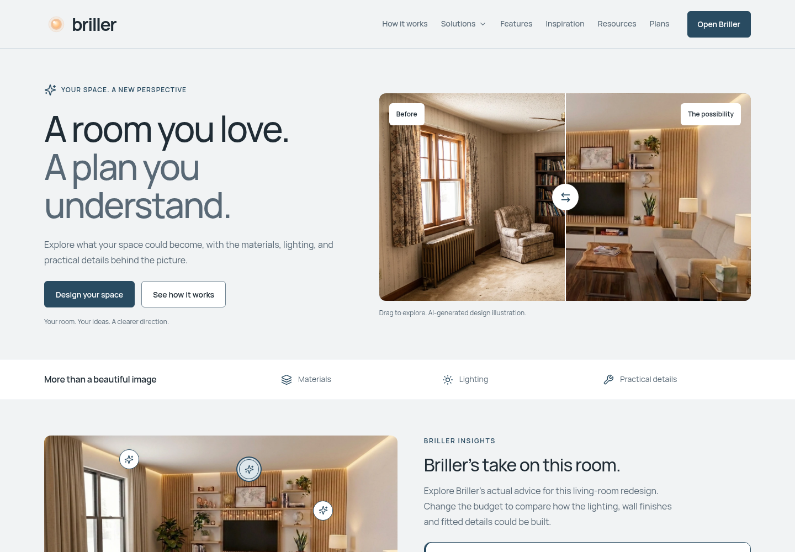
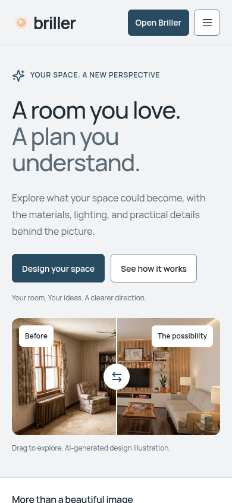
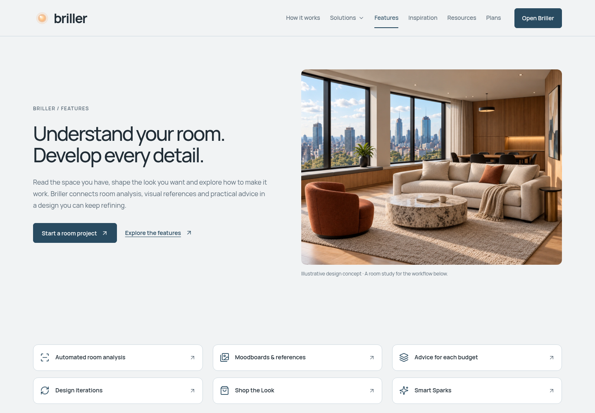
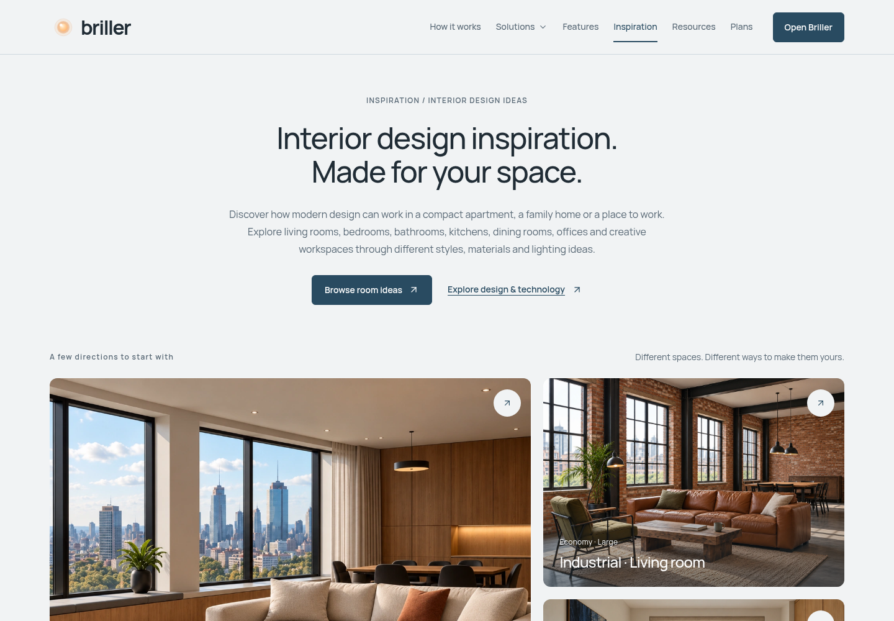
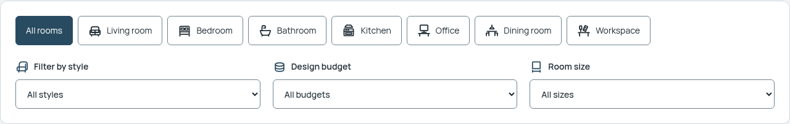
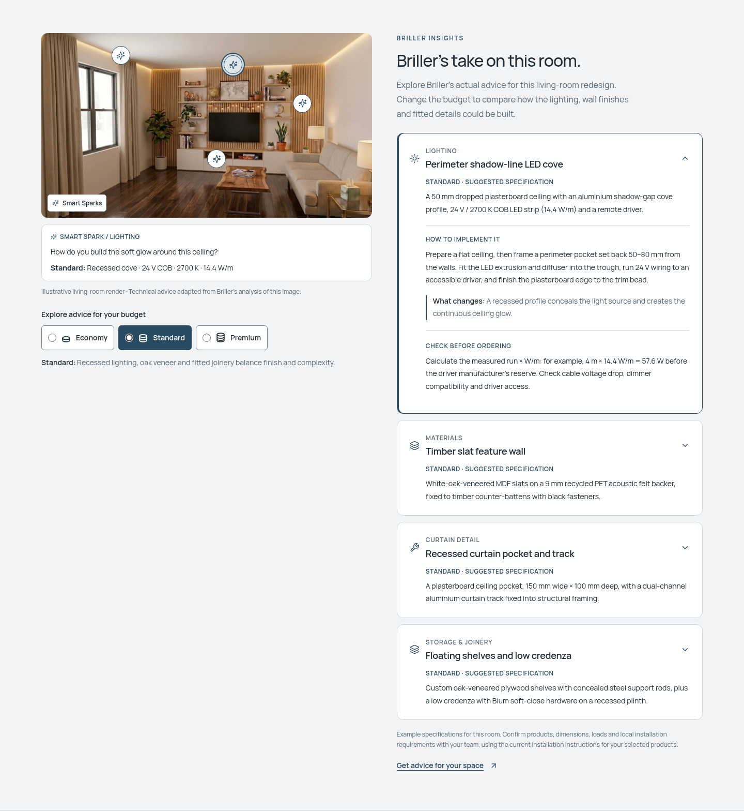

# Briller website — Porcelain & Ink Blue preview

Screenshots of the implemented website redesign, based on the selected style guide and supplied category icons.

Source commit: [2badd25](https://github.com/brillerhouse/website/commit/2badd25c3f5798730dd48fbf1129d79cd2057c05) on `preview`.

These are **static screenshots**, not interactive prototype pages. The live website has not been deployed. Review the actual implementation in your local `preview` checkout with `git pull --ff-only` and `npm run dev`.

Existing content files, photos, routes, links and section order were preserved. The existing automatic legal dates refresh during a rebuild. Decorative asterisk glyphs now use vector icons to avoid platform emoji.

Validation: type check and preview build pass; all existing test suites pass. All 78 localized pages were checked at desktop and phone widths. Additional layout checks cover 320/768/1024px. Browser checks cover both languages, keyboard/mobile menus, consent and focus restoration, comparisons, Smart Sparks, budget advice, gallery filtering/copying/versions/loading and pricing controls.

## Homepage — desktop

## Homepage — mobile

## Features

## Inspiration

## Category icons and filters

## Briller advice

