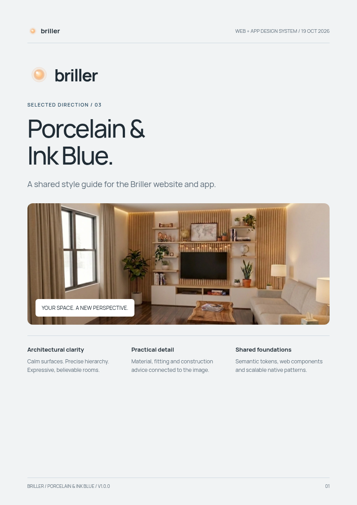

# Briller — Porcelain & Ink Blue

Selected direction 03 · Web & app style guide · v1.0.0 · 19 October 2026

## Read the guide

- [Read the full written guide](STYLE-GUIDE.md)
- [View the PDF](style-guide.pdf)
- [Download the offline visual guide](https://github.com/brillerhouse/website/raw/refs/heads/design-style-guide/briller-style-guide.zip)

Extract the ZIP and open **style-guide.html** in Chrome, Safari, Firefox or Edge. The guide is self-contained, has ordinary section links and requires no JavaScript. The PDF is suitable for sharing or printing. Visual specimens are reduced-scale illustrations; use the production measurements in the text and tokens.

## Implementation files

- `tokens/design-tokens.json` — plain platform-neutral values, with explicit unit metadata.
- `tokens/briller.css` — CSS custom properties and supplied Manrope font registration.
- `tokens/briller.native.ts` — native colour, spacing, radius, size, typography and motion values.
- `tokens/contrast-report.json` — measured opaque sRGB colour pairs; not a full interface audit.
- `assets/` — existing official Briller logo assets and Manrope fonts with the OFL licence.
- `reference-mockups/` — the selected original website and app mockups.

The guide covers identity, colour, typography, layout, components, states, room comparisons, Smart Sparks, budget advice, Inspiration, analysis/references/iteration, Shop the Look, accessibility, localization and acceptance.

This is an implementation handoff. The live website and app code have not been changed or deployed. Brand SVG assets are supplied unchanged. Manrope font usage is subject to the included OFL licence.

