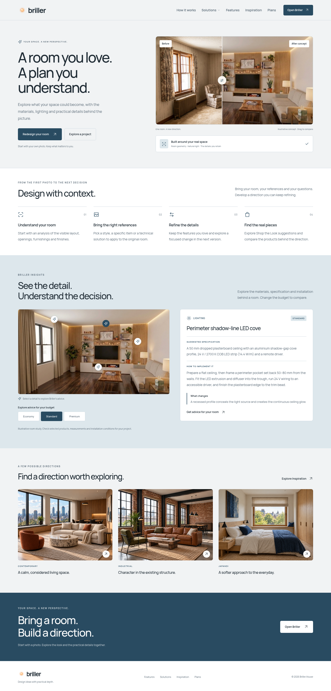
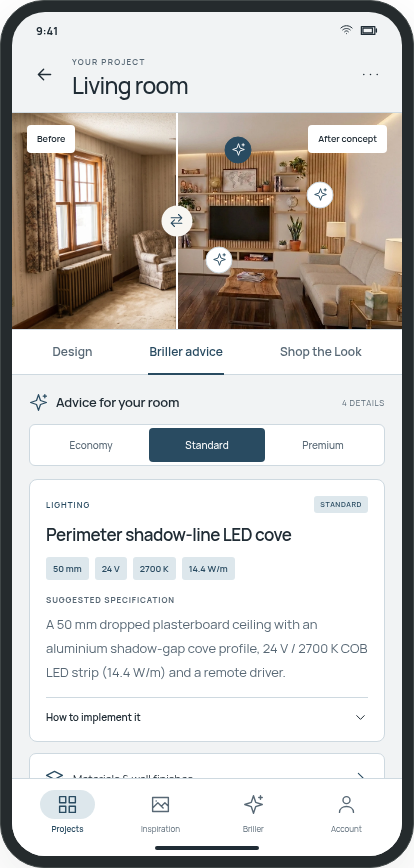

# Briller — Porcelain & Ink Blue

Full web and app style guide · Version 1.0.0 · 19 October 2026

Selected by the user from palette 03. This document specifies a visual system; it does not change or deploy the website/app.

## Contents

- [01. A clear, architectural identity.](#direction)
- [02. Keep the familiar signature.](#identity)
- [03. A restrained working palette.](#palette)
- [04. Make state changes unmistakable.](#states)
- [05. Manrope, with room to read.](#typography)
- [06. A shared grid, adapted to the task.](#layout)
- [07. Precision through repetition.](#space)
- [08. Show credible spaces.](#imagery)
- [09. Actions with a clear hierarchy.](#buttons)
- [10. Fields that explain themselves.](#forms)
- [11. Orient the user at every level.](#navigation)
- [12. Containers that reveal the content.](#cards)
- [13. Two states. One credible room.](#comparison)
- [14. Advice at the point of interest.](#sparks)
- [15. Budget advice with real differences.](#advice)
- [16. A gallery with range and restraint.](#gallery)
- [17. Keep the user’s intent intact.](#workflow)
- [18. Turn a direction into a shortlist.](#shop)
- [19. Explain what is happening.](#feedback)
- [20. Every interaction has an alternative.](#motion)
- [21. Specific, calm and useful.](#language)
- [22. One source, two platforms.](#handoff)
- [23. Review the whole experience.](#release)

# 01. A clear, architectural identity.

Porcelain & Ink Blue brings a precise interface to expressive spaces. Room photography carries the atmosphere; the interface gives the user a calm place to make decisions.

## The selected direction
Use the exact palette from option 03 across the website and app. White work surfaces sit on a cool porcelain canvas, with ink-blue actions and dark slate text. Preserve the existing warm Briller orb as the brand signature.
## Four principles
- **Architecture first.** Use strong alignment, generous margins and a clear reading order. Let the room remain the focal point.
- **Practical depth.** Connect ideas to materials, dimensions, installation methods, limitations and useful sources.
- **One decision at a time.** Present a primary action, clear alternatives and the information needed for the next step.
- **Honest imagery.** Keep credible room geometry, realistic materials and visual continuity between project versions.
## Scope and status
This is the shared light-mode design specification for the marketing website and the app. The selected mockups establish the visual direction; this guide extends them into reusable components and states. Small prototype labels are increased to readable production sizes. New interaction and status colours are specified here, rather than inferred from screenshots.
This guide does not deploy a redesign. Dark mode, a new logo and unimplemented product capabilities are outside version 1.0.0.

# 02. Keep the familiar signature.

Use the official Briller orb and lowercase wordmark. The warm symbol adds a small human counterpoint to the blue interface.

## Logo construction
Use `assets/briller-foreground.svg` for the existing transparent orb and the existing **briller** wordmark in Manrope 700. Use `briller-icon.svg` for the app icon or favicon where the wordmark is impractical. Preserve the orb artwork, gradients and aspect ratio. The wordmark uses the primary text colour on light surfaces.
| Context | Symbol | Wordmark | Gap |
| --- | --- | --- | --- |
| Desktop website header | 40–48 px | 32 px / 700 | 8 px |
| Compact website header | 32–40 px | 28 px / 700 | 8 px |
| App brand placement | 32 px | 24 px / 700 | 8 px |
## Clear space and usage
Keep clear space of at least one quarter of the displayed symbol width around the complete lockup. Use the icon alone below a 24 px symbol size; do not squeeze the lockup to fit. Use a minimum 16 px icon only for favicons and compact system contexts. Prefer light backgrounds for the lockup. A dark-context logo needs a separate contrast review.
Use **Briller** in prose and **briller.house** for the domain. Use the exact English tagline: **YOUR SPACE. A NEW PERSPECTIVE.** The supplied logo is an asset, not an illustration to redraw. Do not replace it with a house icon, recolour the orb blue, add shadows, stretch it or place it inside an extra decorative badge.

# 03. A restrained working palette.

Keep the image expressive and the application chrome quiet. Treat colours as roles, so the same component behaves consistently on every platform.

| Semantic role | HEX | Use |
| --- | --- | --- |
| Canvas | `#F1F3F4` | Main page and project background |
| Surface | `#FFFFFF` | Cards, inputs, dialogs and navigation |
| Primary text | `#202C35` | Headings, body text, essential icons |
| Secondary text | `#586875` | Supporting copy and metadata |
| Accent | `#294B61` | Primary actions, selected elements, links |
| Accent tint | `#DDE7EC` | Selected containers and quiet emphasis |
| Divider | `#CED9E0` | Decorative separators and card edges |
| On accent | `#FFFFFF` | Text/icons on solid accent backgrounds |
## Composition
Use porcelain and white for almost all interface area. Reserve solid ink blue for the main action, selection and occasional closing call to action. The accent tint groups information without adding another saturated colour. Warm timber, fabric and natural light belong in the photographs. Keep those colours faithful to the image.
Colour is not a status by itself: pair selection with a check, radio, border or text label. Use underlined inline links. Blue headings without an action must remain visually distinct from links. Do not use pale divider colour as the only visible boundary of an input or an icon-only control.

# 04. Make state changes unmistakable.

The eight selected colours remain the foundation. These supporting tokens make controls and feedback work in a real product.

| State | Foreground / solid fill | Container / application |
| --- | --- | --- |
| Hover | `#203B4D` | Primary button on pointer hover |
| Pressed | `#172C3B` | Primary button while pressed |
| Focus | `#2C678B` | 2 px outline, 2 px offset |
| Control border | `#6F8391` | Inputs and essential control edges |
| Disabled | `#586875` on `#E5EAED` | Inactive control, no opacity fade |
| Success | `#28624A` on `#E8F1EC` | Check + success message |
| Warning | `#7A5718` on `#F7EFDC` | Warning icon + next step |
| Error | `#9F3B3B` on `#F8EAEA` | Error icon + recovery action |
## Contrast rules
Require 4.5:1 for normal text and 3:1 for large text, meaningful icons, control boundaries and focus indicators. Target 4.5:1 for all text in this system, including captions. Primary text on canvas measures **12.81:1**; secondary text on canvas **5.17:1**; white on accent **9.24:1**.
The included contrast report checks 21 specified colour pairs. It does not establish conformance for entire screens, gradients, image overlays or all component states. Test those in context. Image controls need an opaque white base and a dual white/blue focus ring. Never put supporting grey text directly on a photograph.

# 05. Manrope, with room to read.

Use one family in four registered weights: 400 for reading, 500 for large headings, 600 for labels and 700 for the wordmark or a short emphasis.

| Role | Desktop web size / line | Small web size / line |
| --- | --- | --- |
| Marketing display | 64 / 68, weight 500 | 40 / 44, weight 500 |
| Page title | 48 / 54, weight 500 | 32 / 38, weight 500 |
| Section title | 40 / 46, weight 500 | 28 / 34, weight 500 |
| Subsection | 24 / 32, weight 600 | 22 / 30, weight 600 |
| Card title | 18 / 26, weight 600 | 18 / 26, weight 600 |
| Lead / body / caption | 16 / 26; 14 / 22; 12 / 18 | Same; form-entry text 16 / 24 |
## Native app scale
Use screen title **28/34**, section title **22/30**, card title **18/26**, body **16/24**, label **14/20**, caption **12/18**, in logical units. Enable platform text scaling and flexible height. Essential advice never uses caption size. Controls grow when translated text or accessibility text needs more space.
## Reading and language
Limit paragraphs to about 60–75 characters per line; use shorter lines for technical cards. Keep heading tracking between −0.02 em and −0.04 em, body tracking neutral. Uppercase is only for short 12 px category labels. Do not uppercase paragraphs. Keep units with values: `24 V`, `2700 K`, `50 mm`, `14.4 W/m`. Use tabular numerals for aligned data.
Included Manrope fonts contain Ukrainian glyphs, including Ґ, Є, І and Ї. Use `rem` on web with an unchanged user root size; logical, scalable units in the app. Do not copy the mockup’s tiny 8–11 px presentation labels into the product.

# 06. A shared grid, adapted to the task.

Align section titles, body text, controls and media to a visible structure. Breakpoints respond to available content space rather than a particular device model.

| Width | Grid | Outer gutter | Grid gap | Typical section gap |
| --- | --- | --- | --- | --- |
| Below 640 px | 4 columns | 20 px | 16 px | 48 px |
| 640–959 px | 8 columns | 32 px | 24 px | 64 px |
| 960 px and above | 12 columns | 64 px | 32 px | 80 px |
## Website layouts
Centre content in a maximum **1280 px** container. Available width is viewport minus both gutters. A marketing hero uses 5 columns of copy and 7 of media when content fits; stack copy above media on smaller screens. Keep reading content to **720 px**. Large display type is for the opening message, not every section. At 320 px width, all essential controls and text must reflow.
Place budget selection in a **240–280 px left column** beside advice on desktop; put it above the advice on mobile. At widths where both columns become cramped, stack them. Align headings across the pair. Sticky selectors must remain below the header and stop before the footer.
## App workspace
Use a 20-unit screen inset, 16-unit card padding and 24-unit section separation. Keep the photo full width when comparison detail matters. Use safe-area insets at the top, bottom and display cutouts. App navigation height is content height plus the bottom safe area; never hard-code the mockup’s phone frame. At large text sizes, stack or wrap labels and allow scrolling.

# 07. Precision through repetition.

A small set of repeated distances and shapes creates the professional architectural feeling more effectively than decorative borders.

## Spacing scale
Use **4, 8, 12, 16, 20, 24, 32, 40, 48, 64, 80 and 96** logical units. Four is for a tight icon/label relationship; eight for related text; sixteen for card contents; twenty-four for grouped controls; thirty-two for distinct blocks. Use the larger steps between page sections. Do not use arbitrary values to compensate for inconsistent component sizes.
| Element | Radius | Internal spacing |
| --- | --- | --- |
| Button, field, filter control | 6 px | 12–16 px horizontal |
| Information / advice card | 12 px | 24 px web; 16 px app |
| Room image / comparison | 12 px | No inset within photo |
| Dialog / mobile sheet | 16 px | 24 px; 20 px on narrow screens |
| Small tag / status chip | Full pill | 4 px vertical, 8 px horizontal |
## Borders and elevation
Use 1 px lines for resting boundaries and 2 px for selection. Prefer flat cards with a quiet divider. Use the stronger control-border token for fields. Popovers use `0 4px 16px rgba(32,44,53,0.08)`; dialogs use `0 12px 32px rgba(32,44,53,0.14)`. Native platforms need equivalent shadow/elevation mapping. Use elevation only for overlap, not every gallery card.
## Density
Keep the same visual rhythm in compact areas. An icon-only action can appear 24 px wide, but its target remains 48 units. Add meaningful separation instead of drawing a box around every label. Large rounded capsules are for chips, not every container.

# 08. Show credible spaces.

Use images as evidence of a design direction. Keep iconography economical and let the materials, light and architecture carry the visual interest.

## Icon system
Use a single outline family on a **24 × 24** grid with a **1.75 px** optical stroke, round caps and joins. Use 20 px icons in controls and 24 px in navigation; the Smart Spark has its own brand-shaped outline. Use `currentColor` so selected and feedback states follow tokens. Pair unfamiliar icons with a label. Decorative icons are hidden from assistive technology; functional icons need accessible names.
Keep gallery category icons consistent across room, style, budget and size. Reuse the existing category vocabulary. If using the previously delivered category artwork, adapt it to these stroke and semantic colour rules before implementation; do not mix its separate visual variants within one navigation level.
## Image selection and treatment
Use natural-looking interiors with plausible structure, restrained styling, credible junctions and everyday scale. Avoid repeated arches, distorted openings, unnecessary sloped walls, excessive prop density, warped furniture and impossible reflections. Retain only a small, deliberate minority of genuine attic examples. Assess the image itself; a negative prompt does not certify quality.
Keep white balance and materials believable. Do not apply blue filters to match the interface. Use one strong focal point per card. Preserve source aspect ratio for comparisons. Gallery cards may use a consistent 4:3 crop only after a manual focal-point review. Describe imagery honestly as illustrative concepts or references, according to its origin; never imply a fictional customer project.

# 09. Actions with a clear hierarchy.

Use one primary action per decision group. Keep supporting actions quieter while preserving their visibility and meaning.

| Variant | Appearance | Appropriate use |
| --- | --- | --- |
| Primary | Accent fill, white label | Generate, save a change, open Briller |
| Secondary | White / canvas, control border | Compare options, return to editing |
| Text link | Underlined accent text | Sources, learn more, related content |
| Destructive | Error fill, white label | Confirm deletion after explanation |
## Size and states
Default control height is **48 units**, horizontal padding **16 units**, label **14/20, weight 600**, icon **20** with an 8-unit gap. A compact web variant may be 44 px; shared app controls use 48 units. Increase height for multi-line labels or text scaling. Do not shrink the font to fit a translation.
Primary hover and pressed fills use their state tokens. Secondary hover uses accent tint. Focus is a visible 2 px outline with a 2 px offset. Disabled controls use disabled background/text and a semantic disabled state; explain the unavailable action nearby. Do not put an essential explanation only in a disabled tooltip.
During loading, keep the original width, add an activity indicator and use a specific label such as **Saving…**. Expose busy state, prevent duplicate submission and announce the result. A destructive confirmation names the item and offers **Cancel** and **Delete project**. Do not use **OK** for every action.
An icon-only button must have an accessible name and the same target size as a text action. Arrows support navigation labels; they do not replace them.

# 10. Fields that explain themselves.

Keep labels visible, give constraints before submission and make errors repairable without losing the user’s work.

## Field anatomy
Use a **14/20, weight 600** label above the field, an 8-unit gap, a 48-unit minimum control and helper text below. Inputs use white, primary text, a 1 px control border and a 6 px radius. Entered text is at least **16 px** on mobile web and **16 logical units** in the app. Placeholders are optional examples, never the only label.
The error state adds an error-coloured boundary, an error icon and specific text linked with the field’s description. Keep the focus ring visible even when the input is invalid. Identify required fields in text. Use suitable input modes and autocomplete. Validate after an appropriate interaction or submission, not on every incomplete keystroke.
## Choice and search
Use radios for exactly one choice, checkboxes for multiple choices, switches for immediately applied on/off settings and selects for long lists. Filter chips have a clear selected marker. A removable chip’s close action needs its own name. Search preserves the query and provides a labelled clear action.
## Photo upload
Provide both file selection and drag-and-drop on web; use native library/camera affordances in the app with just-in-time permission copy. Show supported formats and limits from the real service configuration. Expose upload progress, preview, remove and retry. Preserve the rest of the brief after an upload error. Never invent file limits in the interface.
Prompt entry uses a multi-line field and a visible label. Copy-prompt actions announce success; clipboard failures offer selectable text rather than a false **Copied** message.

# 11. Orient the user at every level.

Separate the public website’s discovery tasks from the app’s project workspace while keeping their typography and selection language consistent.

## Marketing website
Use the existing information architecture: **How it works, Solutions, Features, Inspiration, Plans**, plus the primary **Open Briller** action. Keep Inspiration and Features first-class destinations. Solutions may open a grouped menu using real page links. Use ordinary anchors for navigation; use buttons only for actions. Do not introduce links that go to empty placeholders.
Use a 88 px desktop header and a 72 px compact header as starting values, with room for content growth. Collapse navigation when labels stop fitting, not at the expense of a clipped CTA. A mobile menu exposes its expanded state, handles focus, closes with Escape and returns focus to its trigger. Put EN / UK text language links in the footer, preserving the current language-routing behaviour.
## App navigation
Use at most four or five stable destinations in the bottom bar. The concept uses **Projects, Inspiration, Briller, Account**; final labels follow the implemented app architecture. Each has an icon plus text. Selected state uses accent text, a tinted icon container and a programmatic current state.
Project sections such as **Design, Briller advice, Shop the Look** are tabs within a project, not separate global destinations. Keep context when switching tabs. Use native back patterns and warn before discarding unsaved changes. Web tabs support arrow keys and a single tab stop; mark their associated panels. Avoid horizontal label truncation that hides the meaning.
Breadcrumbs are useful for deep solution or inspiration detail pages. Each ancestor must link to a real destination.

# 12. Containers that reveal the content.

Use a small set of card patterns. Typography and grouping should communicate what a card is before the user opens it.

| Pattern | Required contents | Interaction |
| --- | --- | --- |
| Inspiration | Photo, style, room type, title | Open detail with ordinary link |
| Advice | Category, title, budget, specification | Expand implementation details |
| Project | Preview, name, saved state, last update | Open project; separate menu |
| Product | Image, item name, dimensions, source | Open merchant or inspect item |
## Consistent anatomy
Use a white surface, 12 px radius, a 1 px decorative border and aligned internal spacing. Card titles use 18/26. Supporting text uses 14/22 on web and 16/24 for app reading. Keep metadata at 12/18 or larger. Do not stack badges on every edge of a photograph.
For a whole-card link, use one meaningful accessible name and a visible focus state. Avoid nested links or buttons inside another link. If a card needs save and menu actions, give those separate targets outside the primary title link. Images should not reflow as they load: reserve aspect-ratio space.
## Accordions and specifications
Use a button with expanded state, a chevron and a linked content region. Keep the title and the suggested specification visible when useful; put installation steps and budget differences in the expanded region. Preserve open state while switching budget. Native details/summary is acceptable for static web content when its semantics fit.
Specification tables have real headers and units. At small widths, use stacked rows or a labelled scroll region when the data genuinely needs columns. Never make the entire page scroll sideways to accommodate a table.

# 13. Two states. One credible room.

The comparison is a single aligned photo frame, with a movable vertical divider. Preserve the architecture and camera position across both states.

## Composition
Use the same source framing and aspect ratio for before and after, approximately **16:9** for the current homepage pair. Crop neither image independently. Scale both layers identically; the divider reveals the second layer without shifting it. Keep **Before** at the upper left and **After concept** at the upper right in opaque white labels.
Start near a **50/50** split. The handle is a 44–48-unit target with a clear divider and a bidirectional arrow. It remains operable at both extremes without disappearing beyond the frame. Do not create the previous tall, narrow portrait image merely to fill a text column; let the copy and image occupy independent heights.
## Input and accessibility
Use a labelled native range input or an equivalent accessible slider. In the reference mapping, **0 shows all after; 100 shows all before**. Announce a value such as **50% before, 50% after**. Support arrow keys, Home and End, touch dragging and mouse input. Provide explicit **Show before** / **Show after** alternatives. Slider interaction must not block ordinary vertical page scrolling.
## Layout and behaviour
On a solution page, Briller’s take sits to the left and the wide comparison to the right on desktop; stack text then comparison on mobile. Do not overlay long explanations on the room. Keep geometry stable while images load, use a meaningful loading state, and handle a missing image without a broken comparison. Never imply that changing the advice budget changes the pictured render unless a corresponding render exists.

# 14. Advice at the point of interest.

Smart Sparks link a visible design feature to a concrete piece of technical advice. They are small, contextual and anchored to the image.

## Marker and placement
Use an opaque white circular marker, a thin accent outline and the Spark icon. The visible marker can be 32 units on desktop and 36 on mobile; its hit target is at least 48 units. Store positions as normalized image coordinates and account for any letterboxing. Verify the marker points to the actual material, light or joinery discussed.
Use **three to five meaningful markers per image**, separated sufficiently to tap. More markers belong in an advice list. Do not scatter decorative sparkles. In a comparison, a marker appears only when its entire marker and target region are on the revealed after side. Hide the marker and remove it from keyboard/assistive navigation when its feature is covered by the before side. Keep the full advice list available separately.
## Selection and popover
Selecting a marker opens a compact blob over the picture: category, short title and **Read advice** action. Use a maximum width around 260 px, constrained to the photo and viewport. Reposition beside the marker if it would collide with an edge or divider. On narrow screens or large text, use an anchored bottom sheet or the advice panel rather than obscuring the whole image.
Support click, tap and keyboard; do not rely on hover. Provide expanded state, Escape dismissal and predictable focus return. Keep a selected marker visible with a 2 px outline and tinted active state. **Read advice** focuses or scrolls to the matching card while retaining the selected budget.
Do not add a separate **Smart Sparks** heading above the photo or a permanent redundant explanation bar below it.

# 15. Budget advice with real differences.

Each budget changes the specification, implementation and trade-off for the same design decision. It is not merely a price label.

## Selector
Use **Economy / Standard / Premium**, with Standard initially selected. These are advice specifications, not subscription plans. Make the group a labelled single-choice control; selected state combines fill, text and a radio/check indicator. Wrap or stack labels at large text sizes. On desktop, place the selector to the left of the advice; on mobile, directly above it.
Keep the selected Smart Spark and open advice card when changing budget. Update the full related content together, and announce the update without moving focus. Keep the photograph unchanged when only the specification changes. Include one concise note explaining that the image shows an illustrative direction while budgets explore specifications.
## Required advice anatomy
- **Category and meaningful title.** For example, Lighting / Perimeter shadow-line LED cove.
- **Budget · Suggested specification.** Material, finish, profile, dimensions and electrical or hardware characteristics that matter.
- **How to implement it.** Ordered preparation, fixing, services and finishing; name relevant coordination points.
- **What changes.** Explain exactly what the chosen budget substitutes, adds or omits.
- **Checks and references.** Name measurements, product compatibility or specialist checks; include genuinely useful sources.
Avoid repeating the same generic paragraphs across rooms. Separate visible observations from assumptions that need confirmation. Dimensions and named products in the example are a starting specification, not universal approval. Sources support a particular detail; they must not be presented as proof of a site condition that has not been inspected.

# 16. A gallery with range and restraint.

Give users useful ways to explore rooms and copy a brief, while keeping the page editorial and the image collection credible.

## Taxonomy and filters
Use the existing **seven room types**: Living room, Bedroom, Bathroom, Kitchen, Office, Dining room and Workspace. Office describes an enclosed work room; Workspace includes a work zone within a larger space. Keep the current style taxonomy and its localized names as the source of truth. Existing source metadata uses `budget` for the middle variant; display **Standard** where that mapping is appropriate, without renaming source IDs silently.
Expose room, style, budget and space size as labelled filters. Use Small / Medium / Large with actual area values only when those values are available. Keep filter state in a shareable URL on web; provide a clear reset action and a visible result count. Do not hard-code **252** into promotional copy. Announce changed results and keep the selected filters visible.
## Grid and detail
Use three columns on a wide desktop, two at intermediate widths and one on a small phone; use an intentional two-column phone grid only if titles and actions still fit. Preserve image dimensions during loading. A detail view includes the room/style context, a useful suggested redesign prompt, **Copy prompt**, and a clear route into the redesign app. App handoff must use a real supported link or show a copyable brief.
## Image quality gate
Review architecture, furniture scale, joints, reflections, lighting and prop density before publishing. Reject malformed or crowded images; check duplicates and repeated room composition across the collection. Re-review at full resolution and thumbnail size. Automated geometry and similarity checks can flag candidates; human visual review makes the final decision. Keep a review record, source, prompt, room/style/budget/size metadata and rejection reason. More images never outweigh visible quality failures.

# 17. Keep the user’s intent intact.

Analysis, references and iteration should build a legible project history. Preserve the parts of the room the user wants to retain.

## Room analysis
Start from the user’s photo and distinguish **visible observations**, **user-confirmed facts** and **assumptions**. Group the analysis into layout/openings, lighting, finishes, furniture and constraints. Do not show a fabricated confidence percentage or infer hidden structural conditions. Offer a concise editable brief before generation.
## Moodboards as actionable references
A moodboard can supply colour, materials, texture and atmosphere, but also **a technical solution, a fitting, a joinery element, a curtain detail or a specific item** selected from a reference photo. Let the user mark or describe what to borrow and what to retain in the original room. Show a thumbnail, the selected detail and an explicit instruction. A reference is not consent to copy every object or change the room’s geometry.
## Iteration and versions
Keep the source photo, retained features, selected references and brief visible in the project context. Let the user revise one or more instructions, compare versions and restore a previous result. Distinguish **Draft**, **Generating**, **Saved** and **Failed**. Explain whether retrying consumes credits using actual billing rules. Never discard the earlier version merely because a new generation starts.
Show progress as a real service state or an indeterminate indicator. Do not invent countdowns. A failed request preserves the brief and references and offers a relevant retry. A successful generation reveals the result without autoplay motion; comparison starts only when the user is ready. These are behaviour specifications for implementation, not claims that all features already exist.

# 18. Turn a direction into a shortlist.

Connect an item to its role in the room. Keep appearance, dimensions, installation needs and purchase details visibly distinct.

## Product card
Show an honest product image, a descriptive name, the supplier, relevant dimensions, material/finish and the source link. Present price and currency only when available from a reliable source, with an availability or checked-at note where needed. Treat a visual match as a suggestion; never claim an exact match solely from an image.
Use separate actions for **View item**, **Save to shortlist** and **Find alternatives** only when those actions are actually supported. External merchant links should identify the destination. Use an external-link icon with supporting accessible wording; the icon alone is insufficient. Disclose affiliate relationships wherever they apply.
## Compare by useful attributes
Furniture needs dimensions and clearances; lighting needs mounting, power, light output and controls; finishes need substrate and sample information. Put these attributes near the item rather than burying them in an unrelated advice panel. Keep the original room and the selected item in context while browsing alternatives.
Use neutral placeholders for missing product images and explicit text for unavailable prices. A missing price is **Price unavailable**, not zero. Do not invent ratings, discount urgency, stock counts or technical compatibility.
## Purchasing boundaries
The design guide does not add checkout or procurement. If a purchase takes place on another site, make that transition clear. A product recommendation is not a verified construction specification. The user should be able to return to the project with the shortlist and budget context preserved. On mobile, use a sheet or detail screen with a visible close/back action, not a tiny product popover.

# 19. Explain what is happening.

Feedback should acknowledge the user’s action, describe the current state and offer a practical next step.

| State | Message pattern | Behaviour |
| --- | --- | --- |
| Empty project | Add a room photo to begin | One clear upload action |
| No filter results | No rooms match these filters | Keep filters; offer reset |
| Loading / generating | Generating your next version… | Busy state; preserve context |
| Failed upload | This photo did not upload. Try again. | Keep brief and selected files |
| Saved | Version saved | Polite confirmation, no focus theft |
| Offline | You’re offline. Your draft is still here. | Say this only if draft is retained |
## Loading and notices
Skeletons preserve the final layout and image ratio; avoid rapid shimmer. Do not replace useful content with skeletons during a small background update. Toasts are for short, nonessential confirmations. Use about 5–8 seconds as a starting duration, pause while hovered/focused, and keep essential errors or recovery actions visible until resolved.
## Dialogs and mobile sheets
Use a white surface, 16-unit radius, 24-unit padding and the overlay token. The heading names the decision. Constrain dialog width to around 560 px and height to available space; scroll the content rather than hiding the close action. On mobile, honour safe areas and the keyboard. Prevent accidental dismissal during an irreversible action.
A modal traps focus, announces its title, supports an explicit close action and returns focus to its trigger. Escape closes ordinary dismissible dialogs. Native sheets use platform accessibility semantics. Background content must not remain interactable. Inline feedback is preferred when it can explain the issue beside the affected control.

# 20. Every interaction has an alternative.

Use WCAG 2.2 AA as the web acceptance target and native platform accessibility conventions in the app. Visual polish is not evidence of conformance.

## Interaction and reading
- Use at least **44 × 44 CSS px** for ordinary web hit targets; use **48 × 48** for shared controls. iOS targets are at least 44 pt; Android targets at least 48 dp. Do not confuse these with physical pixels.
- Support full keyboard operation, visible focus and a sensible focus order. Sticky bars and sheets must not obscure focused controls.
- Reflow at 320 CSS px and 400% browser zoom. Allow 200% text scaling; verify large native accessibility sizes with scrollable, flexible layouts.
- Use semantic headings, labels, landmarks and accessible names. Announce save/upload/result changes politely; use assertive alerts only for urgent errors.
- Respect contrast, text spacing overrides, high-contrast modes and screen-reader reading order. Describe the room image and the purpose of functional markers.
## Motion tokens
Use **120 ms** for hover/press feedback, **180 ms** for small disclosures and **240 ms** for dialogs or sheets, with `cubic-bezier(0.2, 0, 0, 1)`. Keep slider dragging direct, without easing lag. Do not animate room geometry or simulate camera movements to make an image more dramatic.
Under reduced motion, remove nonessential animation and smooth scrolling; keep an accessible progress indicator or textual busy state. Avoid auto-advancing galleries and parallax backgrounds. Loading indicators must not imply a fabricated progress percentage.
Test VoiceOver and TalkBack on device, and a desktop screen reader with keyboard navigation. The delivered guide includes colour-pair checks, not a full assistive-technology audit of either product.

# 21. Specific, calm and useful.

Write like an experienced design colleague: describe the observation, explain the decision and name the next useful step.

## Product voice
Use short, direct sentences. Prefer **Keep the existing cabinet boxes and replace the fronts** to **Elevate your kitchen experience**. Technical detail earns its place when it changes a decision. Avoid exaggerated claims, invented expertise, guaranteed prices or unsupported certainty. Attribute Mike Briller’s real experience accurately; do not invent quotations or credentials.
Use **Briller** for the assistant and product in user-facing copy. Write action labels as verb + object: **Copy prompt**, **Compare versions**, **Save project**, **View source**. Explain a failure without blaming the user. When a technical detail depends on a site condition, state the condition and the check needed.
## Advice and reference links
Link sources beside the claim they support. Use descriptive labels such as **Manufacturer’s LED profile installation sheet**. Prefer a small number of credible, relevant references to repetitive outgoing links. Link related Briller solutions where they genuinely help. A source is not a purchase endorsement, and a reference card must lead somewhere real.
## EN / UK and units
Maintain matching features and meaning across English and Ukrainian, with room for longer labels. Use locale-aware dates, currency and number formatting. Keep metric units explicit; provide conversions only when they are available and accurate. Use a nonbreaking space between value and unit where supported. Do not replace language names with country flags.
Technical labels, errors, accessible names, filters and copied prompts all need localization. Keep a stable room/style vocabulary and distinguish advice budgets from subscription plans. Do not hard-code counts, prices or entitlements that already have an authoritative content source.

# 22. One source, two platforms.

The handoff includes a readable specification, a visual reference and the same semantic tokens in web and native formats.

## Included files
| File | Purpose |
| --- | --- |
| `STYLE-GUIDE.md` | Searchable, versionable written specification |
| `style-guide.html` / `.pdf` | Illustrated reference; HTML works offline |
| `tokens/design-tokens.json` | Platform-neutral values and unit metadata |
| `tokens/briller.css` | Web custom properties and font registration |
| `tokens/briller.native.ts` | Native colour, spacing and type exports |
| `tokens/contrast-report.json` | Measured colour pairs and thresholds |
| `assets/` | Existing official logo and licensed Manrope fonts |
## Adoption sequence
First map existing semantic tokens to this palette; then apply type, spacing and layout rules; then migrate shared components and their states. Review the main navigation, gallery, project workspace and advice flows as a group. Compare against the selected mockups, using this guide’s readable type and target sizes where the presentation mockup was smaller.
Import the CSS at its supplied relative path, or update font URLs when relocating it. Register Manrope-Regular, Manrope-Medium, Manrope-SemiBold and Manrope-Bold before using the native export. Keep app text scaling enabled. CSS-only shadows need platform-specific native mapping. The JSON is a plain interchange source, not a claimed ready-made proprietary design-tool library.
Version changes to tokens and components together. Record a migration note for a renamed role, changed unit or removed token. Run visual regression checks at representative web widths and native text sizes. These files define the system; they are not installed in either product by creating this guide.

# 23. Review the whole experience.

Use this checklist for design reviews and implementation acceptance. A component is ready only when its real content and less convenient states work.

## Visual and content checks
- Palette roles match the token source; the warm official orb remains unchanged. Room images retain natural colours and plausible architecture.
- Titles, body text and captions follow their roles. Technical advice is readable on mobile; no inherited 8–11 px mockup labels remain.
- Layouts fit 320, 390, 768, 1024 and 1440 CSS px, plus wide desktop and relevant native windows. Long English/Ukrainian labels do not clip.
- Gallery filters, category names, counts, prices and subscription entitlements come from their real data sources. Every link has a useful destination.
## Behaviour and accessibility checks
- Test default, hover where applicable, pressed, focus, selected, disabled, loading, error and success states. Essential meaning is never conveyed by colour alone.
- Compare image layers stay aligned; keyboard and touch controls work at both extremes. Covered Smart Sparks leave the focus order; the advice list stays available.
- Economy / Standard / Premium update the entire selected advice while preserving image, selected detail, focus and expanded state.
- Upload, generation, retry, cancellation and unsaved edits preserve the promised context. Copy actions report actual success or failure.
- Check screen readers, contrast in context, 200% text scaling, 400% zoom, reduced motion, keyboard focus, safe areas and software keyboard overlap.
## Record what passed
Capture viewport, platform, locale, text size, component state and any known limitation. Do not label an entire product accessible because the token contrast report passes. Release implementation only through the project’s normal reviewed deployment process.

## Reference mockups

These show the chosen original direction. The specification above supersedes small presentation text and targets in these images.

